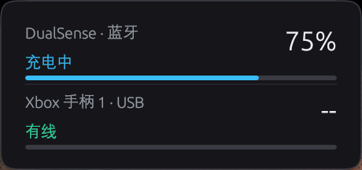
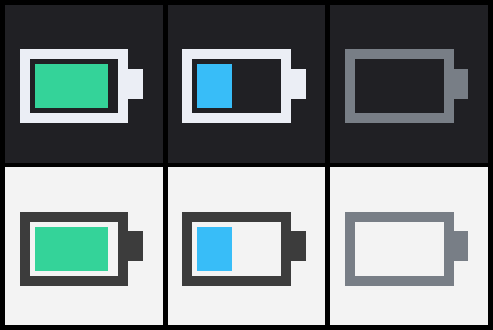

# Controller Battery

[](https://github.com/xuvoxuvo/controller-battery/actions/workflows/ci.yml)
[](LICENSE)

一个常驻桌面的小卡片，随时看一眼手柄还剩多少电。单个 exe，不装运行时，Win10/11 直接跑。



## 特性

- **多手柄**：每只手柄一行，窗口高度自动适配；
- **多协议**：DualSense / DualSense Edge、DualShock 4、Switch Pro / Joy-Con、Xbox / XInput、8BitDo Ultimate 2（DInput）、BLE 手柄；
- **托盘图标**：显示电量与充电状态，左键显示/隐藏卡片，右键菜单；
- **多语言**：跟随系统，或切换简体中文 / 繁體中文 / English；
- **空闲自动隐藏**：可选，倒计时后淡出，手柄恢复上报时淡入；
- **轻量**：单文件约 4 MB，零运行时依赖。

## 支持的设备

| 设备 | 连接 | 电量来源 | 精度 |
| --- | --- | --- | --- |
| DualSense（`054C:0CE6`） | USB / 蓝牙 | HID `status[0]` | 10% |
| DualSense Edge（`054C:0DF2`） | USB / 蓝牙 | HID `status[0]` | 10% |
| DualShock 4（`054C:05C4` / `09CC` / `0BA0`） | USB / 蓝牙（实验性） | HID 状态字节 | 10% |
| Switch Pro / Joy-Con（`057E:2009` / `2006` / `2007`） | USB / 蓝牙（实验性） | HID 报文第 2 字节 | 五档 |
| Xbox 手柄 | USB / 无线适配器 | XInput | 四档 |
| 8BitDo 等 XInput 兼容手柄 | 2.4G 接收器 | XInput | 四档（部分型号不提供） |
| 8BitDo Ultimate 2 Wireless（`2DC8:6012`，DInput） | 2.4G 接收器 / USB 线 | HID 报文第 14 字节 | 1% |
| 8BitDo 等 BLE 手柄 | 蓝牙 | BLE Battery Service | 1% |

## 快速开始

1. 从 [Releases](https://github.com/xuvoxuvo/controller-battery/releases) 下载 `controller-battery.exe`；
2. 双击运行，卡片会出现在桌面上；
3. 手柄连上后自动显示电量（蓝牙手柄需先在系统设置里配对）。

> 已经运行时再次双击 exe 不会开第二份，只会把现有卡片显示出来。

## 使用

### 卡片

- 无边框、置顶、可拖动；位置记在 `%LOCALAPPDATA%\ControllerBattery\settings.json`；
- 右键菜单：
  - 「隐藏到托盘」——收进通知区，靠托盘图标找回；
  - 「空闲时自动隐藏」——见下文；
  - 「语言」——切换界面语言；
  - 「退出」。
- 某行变灰并显示「空闲」，表示手柄暂时停止上报，数字是最后一次读数。

### 托盘图标



- 左键：显示 / 隐藏卡片；
- 右键：显示卡片 / 隐藏卡片 / 退出；
- 悬停：手柄名、电量和状态；
- 图标随电量和充电状态变色，并自动适配浅色 / 深色任务栏。

> Windows 11 默认把新图标折叠进通知区的「^」里。点开「^」就能看到；也可以右键任务栏 →「任务栏设置」→「其他系统托盘图标」把 Controller Battery 打开。

> 托盘图标找不到，或「隐藏到托盘」是灰的：见 [疑难排查](docs/troubleshooting.md)。

### 空闲自动隐藏（可选）

在卡片右键菜单勾选后：

- 手柄停止上报约 1 秒判定为空闲；
- 卡片切到「未检测到手柄，3 秒后隐藏」并倒计时；
- 倒计时结束，约 2 秒淡出；手柄重新上报时淡入；
- 点击或拖动卡片会立刻取消倒计时，淡出进行中也能打断；
- 从托盘显示卡片后有 5 秒缓冲，不会立刻又收起；
- 第一次隐藏会弹一次气泡，提示图标位置和退出方式。

### 多语言

- 默认跟随 Windows 界面语言；
- 可在卡片右键菜单 →「语言」里切到简体中文 / 繁體中文 / English；
- 选择写入 `settings.json`，重启后保持。

## 电量精度

| 来源 | 显示方式 |
| --- | --- |
| DualSense / DualShock 4 | 0–10 档位，显示档位中点（档位 2 → 25%，真实区间 20–30%） |
| Switch Pro / Joy-Con | 空 / 低 / 中 / 高 / 满 五档 |
| XInput | 空 / 低 / 中 / 满 四档 |
| 8BitDo（DInput）/ BLE Battery Service | 1% 百分比 |

这是硬件上限，不是软件取整。

## 已知限制

- **手柄空闲**：停止上报后数字不再变化，插拔充电线也不触发刷新——按键或摇杆才会更新；
- **蓝牙 DualSense**：偶尔发送「简化报文」，电量不刷新；程序会尝试切回全量报文，失败时显示 `≈` 与「状态未知」；
- **第三方手柄**：部分型号（如盖世小鸡）无线连接时不上报电量，显示 `--` 与「未报告电量」；切到蓝牙通常能读到；
- **8BitDo Ultimate 2**：只有按住 `B` 开机（DInput 模式）才上报电量；正常开机走原生 XInput，读不到电量；
- **DualShock 4 / Switch Pro / Joy-Con**：按开源内核协议实现并含报文单测，尚未经真机实测；Switch Pro 首次接入需要切换输入报文模式，若被其他软件独占可能回退只读。

协议细节见 [docs/protocol.md](docs/protocol.md)。

## 构建

需要 Rust 1.75+：

```powershell
cargo build --release
# 产物：target\release\controller-battery.exe
```

构建脚本、真机调试、CI 与发布流程见 [docs/development.md](docs/development.md)。

## 文档

- [开发与发布](docs/development.md)
- [疑难排查](docs/troubleshooting.md)
- [协议笔记](docs/protocol.md)
- [架构说明](docs/architecture.md)
- [AI 协作者说明](AGENTS.md)

## 许可证

[MIT](LICENSE)
